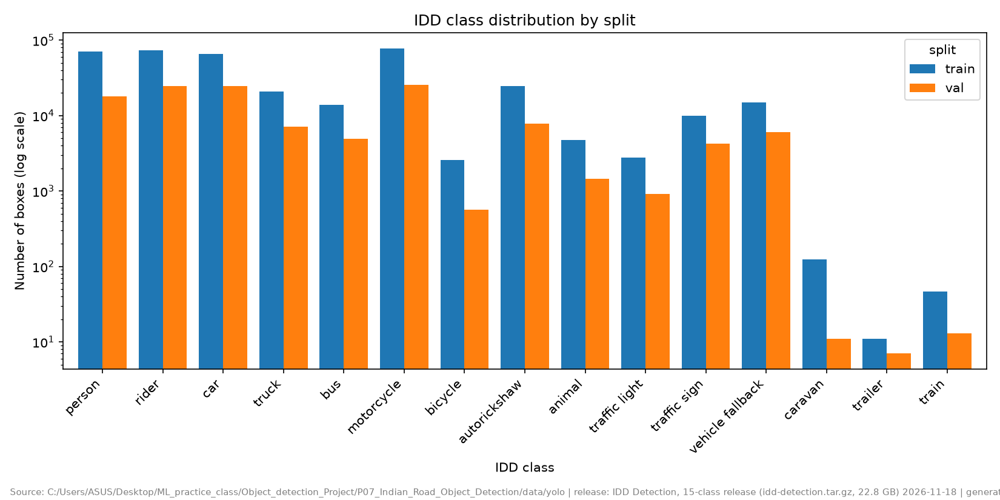
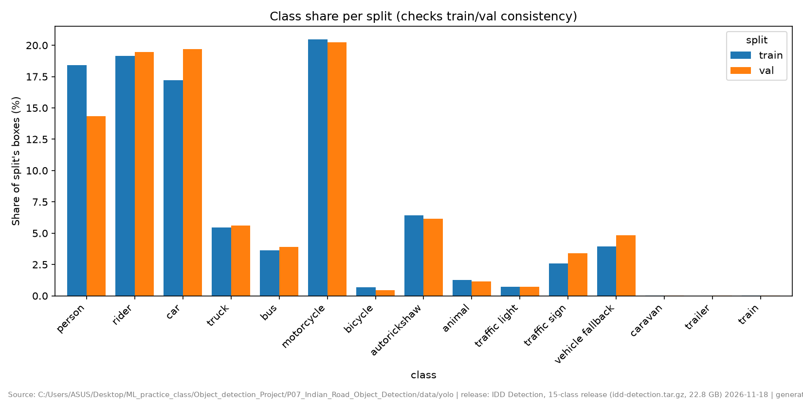
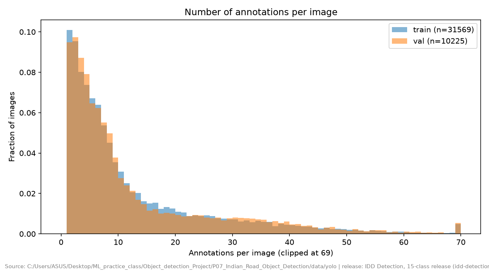
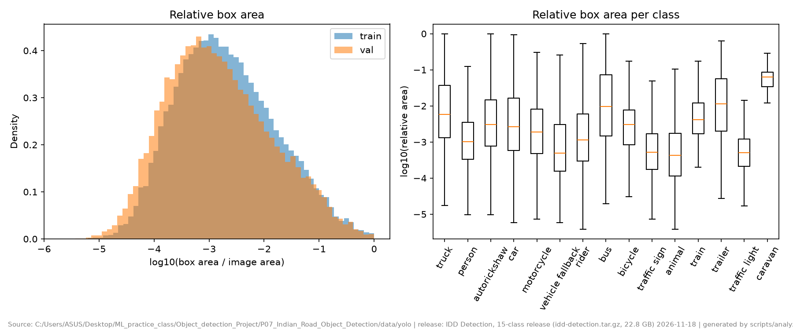
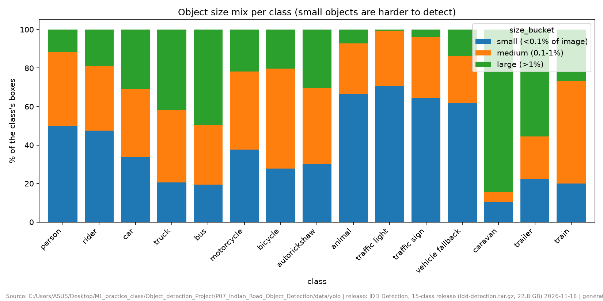

# Dataset report: IDD Detection

Every field below is measured from the real download and from the outputs of
`scripts/inspect_annotations.py`, `scripts/prepare_dataset.py` and `scripts/analyze_dataset.py`.
No field is left as `TBD`.

Dataset state: 41,794 images converted to YOLO at 640 px (31,569 train / 10,225 val),
507,574 boxes, 15 classes, 2.48 GB on disk. Test split is image-only and not converted.

## 1. Release
| Item | Value |
|---|---|
| Release name / version | IDD Detection, 15-class detection release (`idd-detection.tar.gz`, 22.8 GB) |
| Download date | 2026-11-18 |
| Source URL | https://idd.insaan.iiit.ac.in/dataset/details/ |
| Licence accepted | Yes (IDD account, download token issued 2026-11-18) |

## 2. Splits (exact counts from the files)
| Split | Images | Annotated | Notes |
|---|---|---|---|
| train | 31,569 | 31,569 | |
| val | 10,225 | 10,225 | used for model selection and the quantitative comparison |
| test | 4,794 | 0 | images only: the public release ships no test XML, so test is not converted |

## 3. Annotation findings (checklist from the project plan, section 4.4)
- [x] Official detection package downloaded
- [x] Annotation directory and extensions inspected: `Annotations/` holds 41,857 `.xml`, `JPEGImages/` holds 46,659 `.jpg`. Images are nested as `JPEGImages/<camera>/<sequence>/<frame>.jpg` and the split files list stems in the matching form `frontFar/<sequence>/<frame>` with no extension, so `find_image()` resolves without any path rewriting.
- [x] At least 5 annotation files opened (list them): `frontFar/BLR-2018-03-22_17-39-26_2_frontFar/0000060.xml`, `.../001542_r.xml`, `.../000702_r.xml`, `.../0001500.xml`, `highquality_16k/15-07-18-upload/0001957.xml`
- [x] Class taxonomy and ids identified: 15 classes, ids 0..14 in `configs/class_mapping.yaml` order (person, rider, car, truck, bus, motorcycle, bicycle, autorickshaw, animal, traffic light, traffic sign, vehicle fallback, caravan, trailer, train). The names observed in 3,000 real files match the mapping exactly, including the space-containing `traffic light`, `traffic sign` and `vehicle fallback`.
- [x] Bounding-box coordinate format: absolute pixel corners, **0-based** inclusive-ish; observed range `xmin/ymin >= 0` to `xmax/ymax <= 1921/1080`. Caveat: the XML writes the `<bndbox>` children in the non-standard order `xmin, ymax, xmax, ymin`, so a positional parser would silently swap the y-axis. `src/preprocessing/voc.py` reads by tag name and is unaffected.
- [x] Annotation file format (JSON / XML / txt): XML, Pascal-VOC style (`<annotation><size><object><bndbox>`); detected as `voc_xml` with 0 parse problems across 3,000 files.
- [x] Train and val annotations complete: yes, 41,794 split entries against 41,857 XML files on disk.
- [x] Test annotations available: no.

Additional finding, image resolutions declared in the XML over a 3,000-file sample: `1920x1080` 85%, `1280x964` 11%, `1921x1080` 3%, `1280x720` 1%. The odd `1921x1080` is genuine, not a typo: the JPEG itself is 1921 px wide, so the XML agrees with the image and the aspect-mismatch guard in `convert.py` does not fire.

## 4. Preprocessing and validation
Taken from `data/yolo/conversion_report.json` and `conversion_issues.csv`.

Full run over both splits, no `--limit`, images resized so the longer side is 640 px
(`prepare_dataset.py --splits train val --max-side 640`, 24.7 min, ~28 images/s).

| Item | train | val |
|---|---|---|
| Images converted | 31,569 | 10,225 |
| Boxes kept | 381,515 | 126,059 |
| Boxes dropped (invalid / unknown class) | 1 / 0 | 1 / 0 |
| Boxes clipped to image | 195 | 68 |
| Images skipped (missing/corrupt) | 0 | 0 |
| Boxes per image (mean) | 12.08 | 12.33 |
| Output size on disk | 1.88 GB | 0.60 GB |

Test (4,794 images) is deliberately not converted: the public release ships no test XML and the
converter reports a missing split file as unavailable rather than guessing labels.

Unexplained issue codes remaining: none. All 273 logged rows are explained, and each one still
produced a usable image:

| Code | Severity | Rows | Meaning |
|---|---|---|---|
| `out_of_bounds_clipped` | warning | 263 | boxes crossed the image edge, clipped to it and kept |
| `tiny_box` | warning | 8 | shorter box side below `min_box_side_px: 2`, kept |
| `non_positive_size` | error | 1 | degenerate box (xmax <= xmin or ymax <= ymin), dropped |
| `empty_after_clip` | error | 1 | box collapsed to zero area once clipped, dropped |

Absent codes, i.e. every structural check passed on all 41,794 images: `missing_image`,
`missing_annotation`, `unknown_class`, `size_mismatch_xml_vs_image`, `aspect_mismatch_skipped`,
`corrupt_image`, `annotation_problem`, `no_valid_objects`.

Post-conversion validation (`src/preprocessing/validate.py`): **0 errors, 5 warnings**, all
`duplicate_box` — the same class with an identical normalised box appears twice in 5 images.
Harmless for training, but they mean those images hold one annotation error each.

Note on the 1,000-image sample gate: it reported 5.30 train / 2.99 val boxes per image, which
looked like a train/val gap. On the full data it is 12.08 vs 12.33 (val slightly *higher*), so the
gap was sampling bias from reading only the first 1,000 lines of each split file, not a dataset
property.

## 5. Class distribution and statistics
Figures are in `results/eda/`. Summary numbers come from `results/eda/eda_stats.json`.
### Per-class boxes

| Class | train | val | pooled | % of val boxes |
|---|---|---|---|---|
| rider | 73,108 | 24,518 | 97,626 | 19.45% |
| motorcycle | 78,119 | 25,489 | 103,608 | 20.22% |
| person | 70,319 | 18,078 | 88,397 | 14.34% |
| car | 65,676 | 24,843 | 90,519 | 19.71% |
| autorickshaw | 24,498 | 7,782 | 32,280 | 6.17% |
| truck | 20,759 | 7,078 | 27,837 | 5.62% |
| vehicle fallback | 14,992 | 6,089 | 21,081 | 4.83% |
| bus | 13,829 | 4,916 | 18,745 | 3.90% |
| traffic sign | 9,916 | 4,287 | 14,203 | 3.40% |
| animal | 4,764 | 1,460 | 6,224 | 1.16% |
| traffic light | 2,779 | 919 | 3,698 | 0.73% |
| bicycle | 2,573 | 569 | 3,142 | 0.45% |
| caravan | 125 | 11 | 136 | 0.009% |
| train | 47 | 13 | 60 | 0.010% |
| trailer | 11 | 7 | 18 | 0.006% |

### Answers to the checklist

- **Class imbalance (max/min non-zero):** **5,756 : 1** pooled (`motorcycle` 103,608 vs `trailer` 18).
  Per split it is steeper in train (rider 73,108 / trailer 11 = 6,646 : 1) than in val
  (motorcycle 25,489 / trailer 7 = 3,641 : 1).
- **Classes with zero boxes in a split:** **none.** All 15 classes appear in both train and val, so
  there is no class the model can never learn or never be validated on.
- **Annotations per image (mean / median / max):** train **12.09 / 7 / 121** (std 13.41), val
  **12.33 / 7 / 125** (std 13.92). Minimum is 1 in both splits and
  `images_without_objects` is empty, so every converted image carries at least one box.
  Median 7 vs mean 12 means the distribution is strongly right-skewed: most scenes are moderate,
  a long tail of dense traffic scenes drives the mean up.
- **Small-object share:** defined as relative area < 0.1% of the image.

  | Bucket | train | val |
  |---|---|---|
  | small (<0.1% of image) | 150,418 (**39.4%**) | 58,167 (**46.1%**) |
  | medium (0.1-1%) | 142,321 (37.3%) | 41,876 (33.2%) |
  | large (>1%) | 88,776 (23.3%) | 26,016 (20.6%) |

  At the 640 px training resolution 0.1% of the frame is only ~230 px², i.e. a ~15 px side.
  Two fifths of all boxes are therefore barely resolvable after downscaling.

### Train vs val consistency

Overall the two splits agree closely, which is what we want before trusting a val-based
comparison:

| Measure | train | val |
|---|---|---|
| Images | 31,569 | 10,225 |
| Boxes | 381,515 | 126,059 |
| Boxes per image | 12.09 | 12.33 |
| Median boxes per image | 7 | 7 |
| Images with >=1 box | 100% | 100% |
| Classes present | 15/15 | 15/15 |

Group shares (from `configs/class_mapping.yaml`) are also within ~1 point of each other, so the
splits are not drawn from visibly different scenes:

| Group | train | val |
|---|---|---|
| common | 254,101 (66.6%) | 81,905 (65.0%) |
| ambiguous | 87,788 (23.0%) | 30,265 (24.0%) |
| india-specific | 39,626 (10.4%) | 13,889 (11.0%) |

Two differences are real and worth carrying into the results discussion:

1. **val is slightly denser and smaller-object-heavy** — 46.1% small boxes vs 39.4% in train, and
   12.33 vs 12.09 boxes per image. Val will therefore score a little lower than train for reasons
   that are distributional, not only overfitting.
2. **The rare classes are split unevenly** — `caravan` 125 train / 11 val, `trailer` 11 / 7.
   A per-class AP for `trailer` rests on 7 val boxes in total, so it is effectively noise. Report it
   but do not draw conclusions from it.

### Figures

Raw numbers: `results/eda/eda_stats.json`, `results/eda/class_counts.csv`.
Generated by `scripts/analyze_dataset.py` (128 s over 41,794 label files).

## 6. Known limitations

1. **No test annotations.** The public release ships `test.txt` but no test XML, so the 4,794 test
   images are never converted. Val is the only labelled hold-out, and it is used both for model
   selection and for the quantitative comparison. Any reported number for the chosen model is
   therefore mildly optimistic. Fix if required: split a slice of train off as a second hold-out.
2. **Three classes are statistically unusable.** `trailer` (18 boxes), `train` (60) and `caravan`
   (136) together are 0.04% of the dataset. `trailer` has 7 val boxes, so its AP is noise. They are
   kept in the 15-class label space because removing them would change every class id and break
   comparability, but no claim should rest on them.
3. **Small objects dominate.** 39.4% (train) / 46.1% (val) of boxes are under 0.1% of the image
   area. After the 640 px downscale that is roughly a 15 px object, which even a strong detector
   will miss often. This is a property of Indian driving scenes, not a bug, but it caps achievable
   mAP. If small-object recall matters, retrain at 960-1280 px (the converter supports it via
   `--max-side`) and compare.
4. **The 640 px dataset loses absolute resolution.** Labels are normalised so they stay correct,
   but fine detail is gone. All figures in this report are computed on normalised area and are
   therefore unaffected, so preprocessing did not distort the analysis.
5. **5 duplicate boxes** (identical class and normalised box twice in one image) survive in the
   dataset, and **2 degenerate boxes** were dropped (one per split). Impact is negligible at this
   scale but it means those 7 images each hold one annotation error.
6. **263 clipped boxes.** Boxes crossing the image border are clipped and kept. Clipping can shrink
   a box slightly relative to what the annotator drew, which marginally affects IoU-based metrics.
7. **Aspect-ratio guard is untested on real failures.** No image in the release actually tripped
   `aspect_mismatch_skipped`, so that code path is present but unproven.
8. **Only the detection release is used.** IDD segmentation, multimodal, temporal and IDD-117k were
   not downloaded; nothing here claims anything about them.
9. **65 stray JPEGs and 63 stray XMLs** exist on disk that no split file lists. They are ignored by
   design — the converter only reads what the split files name.
