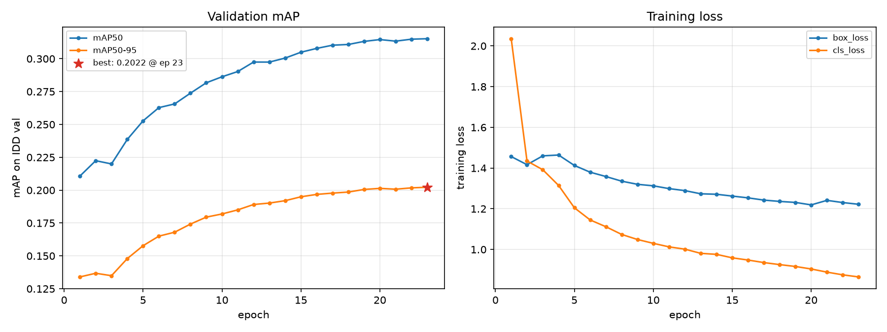
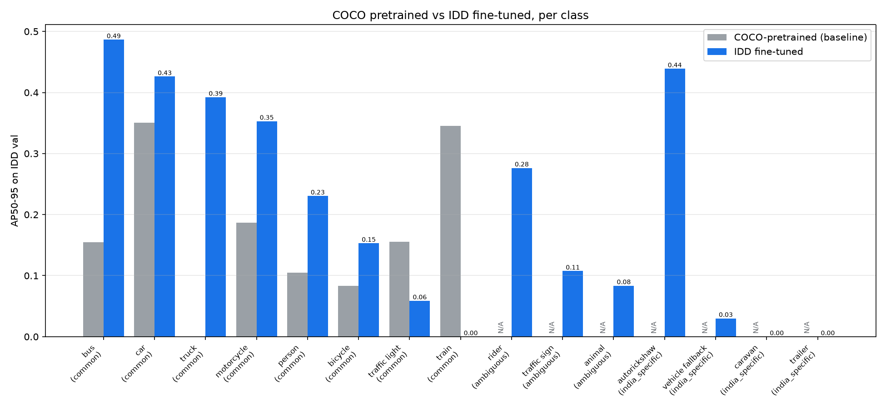

# Results: COCO-pretrained vs IDD fine-tuned

This is the answer to the question the project asks: **how much does region-specific fine-tuning help,
and does it help India-specific classes more than common ones?**

Every number here was produced by an executed run. The commands are at the bottom.

---

## 1. The answer in short

| Question | Answer |
|---|---|
| Does IDD fine-tuning help at all? | **Yes.** On the 7 comparable classes the mean AP50-95 went **0.148 → 0.300**, a **+103% relative** gain. |
| Where is the gain largest? | **bus (+0.33)**, **truck (+0.39)**, **motorcycle (+0.17)**, **person (+0.13)**. A COCO model scores **0.00** on IDD `truck`; after fine-tuning it reaches **0.39**. |
| Do India-specific classes benefit more? | **They cannot be compared, and that is the finding.** A COCO detector has no output class for `autorickshaw`, `vehicle fallback`, `caravan` or `trailer`, so it is scored **N/A**, never 0. After fine-tuning `autorickshaw` reaches **0.439** — the second-best class in the whole model, above `car`. |
| How much of the dataset is the baseline blind to? | **35.0% of val boxes** (44,154 of 126,059) belong to classes a COCO model cannot name. |
| Any regressions? | Two: `traffic light` (0.155 → 0.059) and `train` (0.346 → 0.000). Both are discussed in §6. |

---

## 2. What was actually compared

Both sides are the **same architecture** (`yolo11n`) evaluated on the **same 10,225 val images** at
**640 px** with `conf=0.001, iou=0.7`. The only difference is the weights.

| | Baseline | Fine-tuned |
|---|---|---|
| Weights | `yolo11n.pt` (COCO, as shipped) | `models/best.pt` (23 epochs on IDD) |
| Classes | 80 COCO | 15 IDD |
| Images | 10,225 | 10,225 |
| Device | CPU (inference only) | CPU (inference only) |

### Why the two runs are not scored on the same 15 classes

A COCO model literally cannot emit `autorickshaw`. Scoring it as 0 would be inventing a miss that the
model never had the chance to make. So the baseline run translates the IDD ground truth into COCO ids
first, and only for classes the mapping in `configs/class_mapping.yaml` calls a **direct match**
(`group: common` with exactly one `coco_id`):

| Scored by the baseline | Excluded, and why |
|---|---|
| person, car, truck, bus, motorcycle, bicycle, traffic light, train | `rider` → COCO `person` (many-to-one, would score against the wrong GT) |
| | `traffic sign` → COCO `stop sign` only (partial) |
| | `animal` → 10 COCO species (many-to-one) |
| | `autorickshaw`, `vehicle fallback`, `caravan`, `trailer` — no COCO equivalent → **N/A** |

Consequence: the baseline's *overall* mAP (0.1546) is computed over 8 classes and 81,905 boxes, while the
fine-tuned overall (0.2025) is over 15 classes and 126,059 boxes. **Those two overall numbers are not
comparable and must not be quoted as a single before/after pair.** The group-level and per-class
comparisons below are the valid ones.

---

## 3. The training run

| | |
|---|---|
| Model | `yolo11n.pt` → 15-class head |
| Epochs completed | **23 of 30** |
| Epochs run at full schedule | no — stopped when Colab's free GPU quota ran out |
| imgsz / batch | 640 / 16 |
| Wall time | **3.77 h** (590 s per epoch) |
| Best epoch | **23** (the last one; `best.pt` and `last.pt` are effectively the same weights) |

### Training curve



| | epoch 1 | epoch 23 |
|---|---|---|
| mAP50 | 0.2107 | **0.3152** |
| mAP50-95 | 0.1340 | **0.2022** |
| train box_loss | 1.456 | **1.222** |
| train cls_loss | 2.035 | **0.865** |
| val box_loss | 1.421 | **1.226** |

**Was 23 epochs enough?** The last five epochs gained `+0.00042` mAP50-95 per epoch. Extrapolating the
same rate to epoch 30 gives ≈ 0.205, i.e. about **+0.003** over the reported 0.2022. The curve was
flattening, not rising steeply, so the missing 7 epochs would move the numbers in the third decimal.
The conclusion in §1 does not depend on them.

The classification loss fell by 58% while the validation box loss moved only 14% — the model spent most
of its budget learning *which class* an object is, not *where* it is. That is consistent with the
hypothesis: the COCO backbone already localises well, and what it lacks is Indian class vocabulary.

---

## 4. Per class



Sorted by group, then by fine-tuned AP. `val boxes` is the number of ground-truth boxes for that class in
the 10,225 val images — it is what decides whether an AP is informative.

| Class | Group | Val boxes | Baseline | Fine-tuned | Δ |
|---|---|---:|---:|---:|---:|
| bus | common | 4,916 | 0.1546 | **0.4866** | **+0.3320** |
| car | common | 24,843 | 0.3505 | **0.4261** | +0.0756 |
| truck | common | 7,078 | 0.0000 | **0.3923** | **+0.3923** |
| motorcycle | common | 25,489 | 0.1866 | **0.3530** | +0.1664 |
| person | common | 18,078 | 0.1048 | **0.2305** | +0.1257 |
| bicycle | common | 569 | 0.0836 | **0.1531** | +0.0695 |
| traffic light | common | 919 | 0.1553 | 0.0588 | **−0.0965** |
| train | common | 13 | 0.3456 | 0.0000 | **−0.3456** |
| rider | ambiguous | 24,518 | N/A | **0.2764** | — |
| traffic sign | ambiguous | 4,287 | N/A | 0.1075 | — |
| animal | ambiguous | 1,460 | N/A | 0.0836 | — |
| autorickshaw | india_specific | 7,782 | N/A | **0.4389** | — |
| vehicle fallback | india_specific | 6,089 | N/A | 0.0300 | — |
| caravan | india_specific | **11** | N/A | 0.0000 | — |
| trailer | india_specific | **7** | N/A | 0.0000 | — |

`N/A` = the baseline has no output class for it. It is **not** a zero.

**6 of the 8 comparable classes improved**, mean **+0.194** over those 6, and **+0.090** over all 8
(the two regressions below pull the second number down).

`autorickshaw` at **0.4389** is worth pausing on: it is a class COCO has never seen, it is 7,782 val
boxes (the 5th most common class in the split), and it beats `car` (0.4261) and `truck` (0.3923).
Fine-tuning did not merely transfer; it learned a genuinely new, frequently-occurring object.

---

## 5. Per group

| Group | Classes scoreable by baseline | Baseline | Fine-tuned (all) | Fine-tuned (supported only) |
|---|---:|---:|---:|---:|
| common | 8 / 8 | 0.1726 | 0.2626 | **0.3001** |
| ambiguous | **0 / 3** | N/A | 0.1558 | 0.1558 |
| india_specific | **0 / 4** | N/A | 0.1172 | **0.2345** |

"Supported only" excludes `caravan` (11 val boxes), `trailer` (7) and `train` (13): an AP computed from
7–13 boxes is noise, not a measurement, and it moves both groups. With those removed the comparison
becomes:

| | Baseline | Fine-tuned | Change |
|---|---:|---:|---:|
| common (7 classes) | 0.1479 | 0.3001 | **+0.1522 (+103%)** |
| india_specific (2 classes) | N/A | 0.2345 | not computable |
| ambiguous (3 classes) | N/A | 0.1558 | not computable |

**How to read this.** The project's hypothesis was "fine-tuning helps India-specific classes more". The
data supports a sharper version of it:

1. For **common** classes the baseline already works, and fine-tuning **doubles** the score. This is
   ordinary domain adaptation.
2. For **India-specific** classes there is no "before" number, because the baseline's head has no slot to
   put them in. The improvement is therefore not a percentage — it goes from **structurally impossible**
   to **0.44 on autorickshaw**. That is a categorically different kind of gain.
3. The `india_specific` group mean (0.1172) is misleadingly low because 2 of its 4 members have 18 val
   boxes between them. Reporting 0.1172 next to common's 0.2626 without this caveat would understate the
   result.

---

## 6. The two regressions

### `traffic light`: 0.1553 → 0.0588

Real, and not noise (919 val boxes). Two plausible causes, neither proven here:
the IDD `traffic light` boxes are small and often partially occluded, and the 15-class head now spends
capacity on classes that occur 10–80× more often. Recall on this class is the thing to inspect next.

### `train`: 0.3456 → 0.0000

Almost certainly noise. `train` has **13 val boxes and 47 training boxes** in the entire dataset. The
baseline scores 0.35 on 13 boxes, the fine-tuned model scores 0.00 — both numbers are essentially a coin
flip. Nothing should be concluded from this row; it is reported because hiding a zero would be worse.

---

## 7. What the baseline is blind to

This is the single most useful number for the project's argument:

```
val ground-truth boxes                126,059
boxes the COCO model can name          81,905   (65.0%)
boxes with no COCO class               44,154   (35.0%)
images left with no evaluable GT          433
```

**More than a third of the objects in an Indian road scene have no name in COCO's vocabulary.** No amount
of confidence-threshold tuning fixes that; it is a property of the label space. This is why the
`india_specific` comparison is N/A rather than "small".

---

## 8. Limitations — read before quoting a number

1. **23 of 30 epochs.** The run was cut short by the Colab free-GPU quota. The curve was flattening
   (see §3), so the expected gain from the missing epochs is ≈ +0.003 mAP50-95.
2. **A single seed.** No run-to-run variance was measured, so treat the three smallest deltas
   (`car +0.076`, `bicycle +0.070`, `traffic light −0.097`) as indicative rather than established, and
   the large ones (`truck +0.392`, `bus +0.332`, `autorickshaw` appearing from nothing) as robust.
3. **`yolo11n` only.** This is the smallest model in the family. A larger backbone would raise every
   number, so the absolute values are not a claim about what YOLO can do in general.
4. **Nano model, CPU evaluation.** Inference ran on CPU with fp32; GPU fp16 would give slightly different
   counts near the detection threshold, though not enough to change the ordering.
5. **The mapping is a judgement call.** `rider → person`, `traffic sign → stop sign` and
   `animal → 10 COCO species` were deliberately left unscored. A different, more generous mapping would
   produce baseline numbers for those classes, and they would not be comparable to these.
6. **`vehicle fallback` (0.0300) is a catch-all.** Its definition ("a vehicle that is none of the above")
   makes it inherently hard; the low AP says something about the taxonomy, not only about the model.
7. **One dataset, one split.** Everything is IDD's own val split. No cross-dataset transfer was tested, so
   "fine-tuning generalises to other Indian roads" is not supported by this experiment.

---

## 9. Reproducing every number

```bash
# 1. the training run (needs a GPU; produced models/best.pt and results/results.csv)
python scripts/train_yolo.py --data-root /content/idd_yolo --model yolo11n.pt \
    --epochs 30 --batch 16 --imgsz 640 --name idd_yolo11n_e30 --project <drive>/runs

# 2. the curve
python scripts/plot_training_curve.py --csv results/results.csv

# 3. the two evaluations (CPU, ~15 min each)
python scripts/evaluate.py --model models/best.pt --tag finetuned --batch 32
python scripts/evaluate.py --model yolo11n.pt --tag coco_baseline --coco-baseline --batch 32

# 4. the comparison table and figure
python scripts/compare_evals.py
```

## 10. Files this report is built from

| File | Contents |
|---|---|
| `results/results.csv` | per-epoch training metrics exactly as the trainer wrote them |
| `results/eval_finetuned.json` | per-class and overall AP of the fine-tuned model |
| `results/eval_coco_baseline.json` | per-class AP of the baseline, plus the N/A reasons |
| `results/comparison.json` | per-class Δ and per-group means |
| `results/training_curve.png` | §3 figure |
| `results/results_compare.png` | §4 figure |
| `docs/dataset_report.md` | the dataset side: counts, imbalance, small-object analysis |
