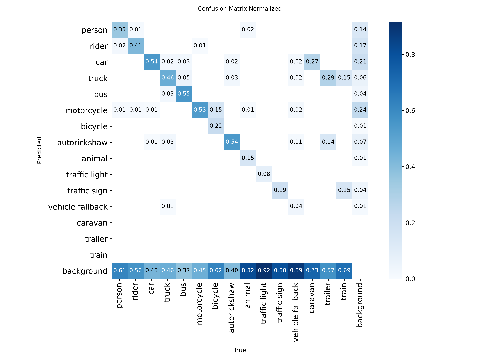
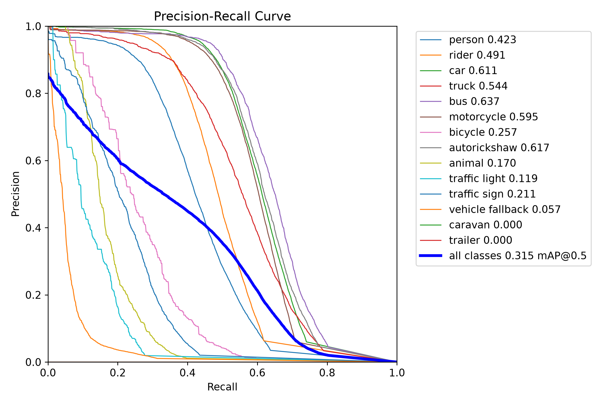

# Results: COCO-pretrained vs IDD fine-tuned

This is the answer to the question the project asks: **how much does region-specific fine-tuning help,
and does it help India-specific classes more than common ones?**

Every number here was produced by an executed run. The commands are at the bottom.

---

## 1. The answer in short

| Question | Answer |
|---|---|
| Does IDD fine-tuning help at all? | **Yes.** On the 7 comparable classes with enough val boxes the mean AP50-95 went **0.177 → 0.300** (+0.123, **+70% relative**). |
| Where is the gain largest? | **truck (+0.24)**, **motorcycle (+0.17)**, **bus (+0.14)**, **person (+0.13)**. `truck` went 0.155 → 0.392, the largest jump in absolute terms. |
| Do India-specific classes benefit more? | **They cannot be compared, and that is the finding.** A COCO detector has no output class for `autorickshaw`, `vehicle fallback`, `caravan` or `trailer`, so it is scored **N/A**, never 0. After fine-tuning `autorickshaw` reaches **0.439** — the second-best class in the whole model, above `car`. |
| How much of the dataset is the baseline blind to? | **35.0% of val boxes** (44,154 of 126,059) belong to classes a COCO model cannot name. |
| Any regressions? | **None on the 7 supported classes.** `train` is 0.000 → 0.000, but it has only 13 val boxes, so it is noise (§6). |

> **Correction (2026-11-22).** An earlier version of this report, and of `results/eval_coco_baseline.json`,
> carried wrong baseline AP for `bus`, `train`, `truck` and `traffic light`: per-class AP was paired with
> class ids by list position instead of by id, which shifts values whenever a class has no ground truth
> (the normal case for the 80-class COCO model). It reported "truck 0.00 → 0.39" and two regressions that
> do not exist. The code is fixed (`ap_by_class_id` in `scripts/evaluate.py`, with a regression test), the
> baseline was re-run, and every number below comes from that re-run. The fine-tuned numbers were never
> affected.

---

## 2. What was actually compared

Both sides are the **same architecture** (`yolo11n`) evaluated on the **same 10,225 val images** at
**640 px** with `conf=0.001, iou=0.7`. The only difference is the weights.

| | Baseline | Fine-tuned |
|---|---|---|
| Weights | `yolo11n.pt` (COCO, as shipped) | `models/best.pt` (23 epochs on IDD) |
| Classes | 80 COCO | 15 IDD |
| Images | 10,225 | 10,225 |
| Device | CPU (inference only) | CPU (inference only) |

### Why the two runs are not scored on the same 15 classes

A COCO model literally cannot emit `autorickshaw`. Scoring it as 0 would be inventing a miss that the
model never had the chance to make. So the baseline run translates the IDD ground truth into COCO ids
first, and only for classes the mapping in `configs/class_mapping.yaml` calls a **direct match**
(`group: common` with exactly one `coco_id`):

| Scored by the baseline | Excluded, and why |
|---|---|
| person, car, truck, bus, motorcycle, bicycle, traffic light, train | `rider` → COCO `person` (many-to-one, would score against the wrong GT) |
| | `traffic sign` → COCO `stop sign` only (partial) |
| | `animal` → 10 COCO species (many-to-one) |
| | `autorickshaw`, `vehicle fallback`, `caravan`, `trailer` — no COCO equivalent → **N/A** |

Consequence: the baseline's *overall* mAP (0.1546) is computed over 8 classes and 81,905 boxes, while the
fine-tuned overall (0.2025) is over 15 classes and 126,059 boxes. **Those two overall numbers are not
comparable and must not be quoted as a single before/after pair.** The group-level and per-class
comparisons below are the valid ones.

---

## 3. The training run

| | |
|---|---|
| Model | `yolo11n.pt` → 15-class head |
| Epochs completed | **23 of 30** |
| Epochs run at full schedule | no — stopped when Colab's free GPU quota ran out |
| imgsz / batch | 640 / 16 |
| Wall time | **3.77 h** (590 s per epoch) |
| Best epoch | **23** (the last one; `best.pt` and `last.pt` are effectively the same weights) |

### Training curve


| | epoch 1 | epoch 23 |
|---|---|---|
| mAP50 | 0.2107 | **0.3152** |
| mAP50-95 | 0.1340 | **0.2022** |
| train box_loss | 1.456 | **1.222** |
| train cls_loss | 2.035 | **0.865** |
| val box_loss | 1.421 | **1.226** |

**Was 23 epochs enough?** The last five epochs gained `+0.00042` mAP50-95 per epoch. Extrapolating the
same rate to epoch 30 gives ≈ 0.205, i.e. about **+0.003** over the reported 0.2022. The curve was
flattening, not rising steeply, so the missing 7 epochs would move the numbers in the third decimal.
The conclusion in §1 does not depend on them.

The classification loss fell by 58% while the validation box loss moved only 14% — the model spent most
of its budget learning *which class* an object is, not *where* it is. That is consistent with the
hypothesis: the COCO backbone already localises well, and what it lacks is Indian class vocabulary.

---

## 4. Per class


Sorted by group, then by fine-tuned AP. `val boxes` is the number of ground-truth boxes for that class in
the 10,225 val images — it is what decides whether an AP is informative.

| Class | Group | Val boxes | Baseline | Fine-tuned | Δ |
|---|---|---:|---:|---:|---:|
| bus | common | 4,916 | 0.3456 | **0.4866** | +0.1410 |
| car | common | 24,843 | 0.3505 | **0.4261** | +0.0756 |
| truck | common | 7,078 | 0.1553 | **0.3923** | **+0.2370** |
| motorcycle | common | 25,489 | 0.1866 | **0.3530** | +0.1664 |
| person | common | 18,078 | 0.1048 | **0.2305** | +0.1257 |
| bicycle | common | 569 | 0.0836 | **0.1531** | +0.0695 |
| traffic light | common | 919 | 0.0104 | 0.0588 | +0.0484 |
| train | common | 13 | 0.0000 | 0.0000 | 0.0000 |
| rider | ambiguous | 24,518 | N/A | **0.2764** | — |
| traffic sign | ambiguous | 4,287 | N/A | 0.1075 | — |
| animal | ambiguous | 1,460 | N/A | 0.0836 | — |
| autorickshaw | india_specific | 7,782 | N/A | **0.4389** | — |
| vehicle fallback | india_specific | 6,089 | N/A | 0.0300 | — |
| caravan | india_specific | **11** | N/A | 0.0000 | — |
| trailer | india_specific | **7** | N/A | 0.0000 | — |

`N/A` = the baseline has no output class for it. It is **not** a zero.

**7 of the 8 comparable classes improved** and none got worse; the 8th, `train`, is 0.000 → 0.000 on 13 val
boxes (§6). The mean change is **+0.123** over the 7 supported classes and **+0.108** over all 8.

`autorickshaw` at **0.4389** is worth pausing on: it is a class COCO has never seen, it is 7,782 val
boxes (the 5th most common class in the split), and it beats `car` (0.4261) and `truck` (0.3923). Only `bus` (0.4866) scores higher.
Fine-tuning did not merely transfer; it learned a genuinely new, frequently-occurring object.

---

## 5. Per group

| Group | Classes scoreable by baseline | Baseline | Fine-tuned (all) | Fine-tuned (supported only) |
|---|---:|---:|---:|---:|
| common | 8 / 8 | 0.1546 | 0.2626 | **0.3001** |
| ambiguous | **0 / 3** | N/A | 0.1558 | 0.1558 |
| india_specific | **0 / 4** | N/A | 0.1172 | **0.2345** |

"Supported only" excludes `caravan` (11 val boxes), `trailer` (7) and `train` (13): an AP computed from
7–13 boxes is noise, not a measurement, and it moves both groups. With those removed the comparison
becomes:

| | Baseline | Fine-tuned | Change |
|---|---:|---:|---:|
| common (7 classes) | 0.1767 | 0.3001 | **+0.1234 (+70%)** |
| india_specific (2 classes) | N/A | 0.2345 | not computable |
| ambiguous (3 classes) | N/A | 0.1558 | not computable |

**How to read this.** The project's hypothesis was "fine-tuning helps India-specific classes more". The
data supports a sharper version of it:

1. For **common** classes the baseline already works, and fine-tuning raises the mean AP by about **70%**
   (0.177 → 0.300). This is ordinary domain adaptation.
2. For **India-specific** classes there is no "before" number, because the baseline's head has no slot to
   put them in. The improvement is therefore not a percentage — it goes from **structurally impossible**
   to **0.44 on autorickshaw**. That is a categorically different kind of gain.
3. The `india_specific` group mean (0.1172) is misleadingly low because 2 of its 4 members have 18 val
   boxes between them. Reporting 0.1172 next to common's 0.2626 without this caveat would understate the
   result.

---

## 6. Two rows to read with care

No supported class regressed, but two rows should not be over-read.

### `traffic light`: 0.0104 → 0.0588

Improved, yet both numbers are low. Fine-tuning raised it about 5.7×, but 0.059 is still the weakest of
the classes with real support (919 val boxes). Likely reasons, neither proven here: IDD `traffic light`
boxes are small and often partially occluded, and the 15-class head spends capacity on classes that occur
10–80× more often. Recall on this class is the thing to inspect next.

### `train`: 0.0000 → 0.0000

Noise. `train` has **13 val boxes and 47 training boxes** in the entire dataset, so neither model gives a
usable measurement. Nothing should be concluded from this row; it is reported because hiding a zero would
be worse.

---

## 7. What the baseline is blind to

This is the single most useful number for the project's argument:

```
val ground-truth boxes                126,059
boxes the COCO model can name          81,905   (65.0%)
boxes with no COCO class               44,154   (35.0%)
images left with no evaluable GT          433
```

**More than a third of the objects in an Indian road scene have no name in COCO's vocabulary.** No amount
of confidence-threshold tuning fixes that; it is a property of the label space. This is why the
`india_specific` comparison is N/A rather than "small".

---

## 8. Precision and recall per class

AP summarises the whole precision-recall curve. Precision and recall below are the values Ultralytics
reports at the confidence that maximises F1 for each class (`box.p` / `box.r`), so they describe one
operating point, not the full curve. Format is `precision / recall`.

| Class | Baseline P / R | Fine-tuned P / R | Fine-tuned AP50 |
|---|---:|---:|---:|
| bus | 0.563 / 0.406 | 0.759 / 0.574 | 0.637 |
| car | 0.656 / 0.458 | 0.748 / 0.545 | 0.611 |
| truck | 0.321 / 0.262 | 0.685 / 0.484 | 0.544 |
| motorcycle | 0.775 / 0.258 | 0.732 / 0.544 | 0.595 |
| person | 0.321 / 0.294 | 0.691 / 0.359 | 0.423 |
| bicycle | 0.348 / 0.165 | 0.503 / 0.238 | 0.257 |
| traffic light | 0.117 / 0.050 | 0.596 / 0.080 | 0.119 |
| train | 0.000 / 0.000 | 1.000 / 0.000 | 0.000 |
| rider | N/A | 0.735 / 0.424 | 0.490 |
| traffic sign | N/A | 0.521 / 0.197 | 0.211 |
| animal | N/A | 0.487 / 0.149 | 0.170 |
| autorickshaw | N/A | 0.726 / 0.558 | 0.617 |
| vehicle fallback | N/A | 0.487 / 0.042 | 0.057 |
| caravan | N/A | 1.000 / 0.000 | 0.000 |
| trailer | N/A | 0.000 / 0.000 | 0.000 |

Reading it: the fine-tuned model's recall is much lower than its precision for most classes (overall
precision 0.645, recall 0.280): when it fires it is usually right, but it misses many objects. The lowest recalls are
`traffic light` (0.080), `vehicle fallback` (0.042) and `animal` (0.149), plus the near-empty `caravan`, `trailer`
and `train`; `traffic light` is a small-object class (see `docs/dataset_report.md`), while `vehicle fallback` is a
catch-all label, so these low recalls have different likely causes. `precision = 1.000` with
`recall = 0.000` for `caravan` and `train` is an artefact, not a good score: at the F1-optimal threshold the
model makes no (or almost no) detections for them, so there is nothing to be wrong about. `trailer` (0.000 / 0.000)
and the baseline's `train` row likewise show no usable detections; with 7-13 val boxes none of these is informative.

Source: `per_class_detail` in `results/eval_finetuned.json` and `results/eval_coco_baseline.json`.

### Confusion matrix and precision-recall curves





Generated by `python scripts/evaluate.py --model models/best.pt --tag finetuned --plots-dir results/eval_plots/finetuned`;
the folder also holds `confusion_matrix.png` (raw counts), `BoxF1_curve.png`, `BoxP_curve.png` and `BoxR_curve.png`.
In the normalised matrix (rows predicted, columns true) the `background` row is the share of real objects with no
detection of the right class: 0.92 for `traffic light`, 0.89 for `vehicle fallback`, 0.82 for `animal`, 0.62 for
`bicycle`, 0.61 for `person`, against 0.37 for `bus` and 0.43 for `car`. Class-to-class confusion is small by
comparison; 15% of true `bicycle` boxes are predicted as `motorcycle`. `trailer` and `caravan` are often labelled
`truck` (0.29) and `car` (0.27), but they have 7 and 11 val boxes, so those shares rest on very few objects.

---

## 9. Qualitative comparison

`scripts/qualitative.py` draws ground truth, the COCO baseline and the fine-tuned model side by side on the
same image (display confidence 0.25). Two galleries are in `results/qualitative/`, with every image listed in
`results/qualitative/index.json`.

**Random sample** (`random_00..07.jpg`): 8 val images drawn with seed 0, nothing hand-picked.

| Image | GT boxes | Baseline detections | Fine-tuned detections | Fine-tuned recall@IoU0.5 | Median GT box area |
|---|---:|---:|---:|---:|---:|
| `random_00.jpg` | 7 | 5 | 6 | 0.71 | 0.250% |
| `random_01.jpg` | 3 | 0 | 0 | 0.00 | 0.016% |
| `random_02.jpg` | 1 | 1 | 1 | 1.00 | 0.428% |
| `random_03.jpg` | 18 | 7 | 7 | 0.28 | 0.049% |
| `random_04.jpg` | 8 | 11 | 10 | 1.00 | 2.632% |
| `random_05.jpg` | 4 | 2 | 7 | 0.75 | 3.333% |
| `random_06.jpg` | 1 | 1 | 2 | 1.00 | 80.863% |
| `random_07.jpg` | 27 | 14 | 19 | 0.63 | 0.127% |

**Failure cases** (`failure_00..07.jpg`): the 8 images with the lowest fine-tuned recall@IoU0.5 among
253 pool images with >= 5 GT boxes, drawn from a seeded pool of 400 val images.

| Image | GT boxes | Baseline detections | Fine-tuned detections | Fine-tuned recall@IoU0.5 | Median GT box area |
|---|---:|---:|---:|---:|---:|
| `failure_00.jpg` | 16 | 0 | 0 | 0.00 | 0.008% |
| `failure_01.jpg` | 11 | 0 | 1 | 0.00 | 0.026% |
| `failure_02.jpg` | 6 | 0 | 0 | 0.00 | 0.019% |
| `failure_03.jpg` | 6 | 2 | 0 | 0.00 | 0.016% |
| `failure_04.jpg` | 6 | 2 | 2 | 0.00 | 0.301% |
| `failure_05.jpg` | 5 | 0 | 0 | 0.00 | 0.005% |
| `failure_06.jpg` | 17 | 0 | 3 | 0.06 | 0.006% |
| `failure_07.jpg` | 11 | 1 | 1 | 0.09 | 0.005% |

What the numbers say (measured, not interpreted): 7 of the 8 failure images have a median
ground-truth box smaller than 0.1% of the image area, against 2 of the 8 random images. The failures are
dominated by images full of tiny, distant objects, consistent with the small-object and `traffic light` findings in
§6 and `docs/dataset_report.md`. Whether the cause is object size, occlusion, lighting or label noise is
**not tested here**; the stored statistics only show that size is strongly associated with failure in this
sample. Both galleries are small samples and illustrate the quantitative tables; they do not replace them.

The baseline panel uses its own 80 COCO names. Where it fires on an Indian-specific object it gives a COCO
label (an autorickshaw in `random_03.jpg` is boxed as `truck`), which is the vocabulary gap from §7 made visible.

---

## 10. Limitations — read before quoting a number

1. **23 of 30 epochs.** The run was cut short by the Colab free-GPU quota. The curve was flattening
   (see §3), so the expected gain from the missing epochs is ≈ +0.003 mAP50-95.
2. **A single seed.** No run-to-run variance was measured, so treat the smallest deltas
   (`traffic light +0.048`, `bicycle +0.070`, `car +0.076`) as indicative rather than established, and
   the large ones (`truck +0.237`, `motorcycle +0.166`, `bus +0.141`, `autorickshaw` appearing from
   nothing) as more likely to hold.
3. **`yolo11n` only.** This is the smallest model in the family. A larger backbone would raise every
   number, so the absolute values are not a claim about what YOLO can do in general.
4. **Nano model, CPU evaluation.** Inference ran on CPU with fp32; GPU fp16 would give slightly different
   counts near the detection threshold, though not enough to change the ordering.
5. **The mapping is a judgement call.** `rider → person`, `traffic sign → stop sign` and
   `animal → 10 COCO species` were deliberately left unscored. A different, more generous mapping would
   produce baseline numbers for those classes, and they would not be comparable to these.
6. **`vehicle fallback` (0.0300) is a catch-all.** Its definition ("a vehicle that is none of the above")
   makes it inherently hard; the low AP says something about the taxonomy, not only about the model.
7. **One dataset, one split.** Everything is IDD's own val split. No cross-dataset transfer was tested, so
   "fine-tuning generalises to other Indian roads" is not supported by this experiment.
8. **Checkpoint chosen on the same split it is scored on.** `best.pt` is the best epoch by val mAP and is then
   evaluated on val, because the public release has no test labels. The reported fine-tuned numbers are
   therefore slightly optimistic. Here the best epoch is also the last one, which limits the effect.

---

## 11. Reproducing every number

```bash
# 1. the training run (needs a GPU; produced models/best.pt and results/results.csv)
python scripts/train_yolo.py --data-root /content/idd_yolo --model yolo11n.pt \
    --epochs 30 --batch 16 --imgsz 640 --name idd_yolo11n_e30 --project <drive>/runs

# 2. the curve
python scripts/plot_training_curve.py --csv results/results.csv

# 3. the two evaluations (CPU, ~15 min each)
python scripts/evaluate.py --model models/best.pt --tag finetuned --batch 32
python scripts/evaluate.py --model yolo11n.pt --tag coco_baseline --coco-baseline --batch 32

# 4. the comparison table and figure
python scripts/compare_evals.py

# 5. the qualitative galleries (CPU)
python scripts/qualitative.py --finetuned models/best.pt --baseline yolo11n.pt
```

## 12. Files this report is built from

| File | Contents |
|---|---|
| `results/results.csv` | per-epoch training metrics exactly as the trainer wrote them |
| `results/eval_finetuned.json` | per-class and overall AP of the fine-tuned model |
| `results/eval_coco_baseline.json` | per-class AP of the baseline, plus the N/A reasons |
| `results/comparison.json` | per-class Δ and per-group means |
| `results/training_curve.png` | §3 figure |
| `results/results_compare.png` | §4 figure |
| `results/qualitative/` | §9 galleries and `index.json` (seed, thresholds, per-image stats) |
| `docs/dataset_report.md` | the dataset side: counts, imbalance, small-object analysis |
